# Gene Studio

A plasmid workbench that runs in one file — circular and linear maps, an
annotated sequence view, restriction digests with a simulated agarose gel, PCR,
cloning, Golden Gate assembly, guide RNA design and Sanger `.ab1` review — by
**Jae-Yoon Sung**.

This repository holds **only the released builds and the version feed**. The
source is not here and is not public: Gene Studio is given to named people for
research, and copying, changing or redistributing it needs written permission.
The terms are in [`LICENSE`](LICENSE), and the same text ships inside the
application.

**[What Gene Studio is, with pictures →](https://genestudio.app/)**
&nbsp;·&nbsp; **[Download the latest build →](../../releases/latest)**

The application opens on a licence window showing a **Machine ID**. Send it to
**genestudio.help@gmail.com** and paste back the licence you are given; it runs
on that computer and nowhere else. The window composes that mail for you — fill
in your name and institution and it fills in the rest.

*macOS*: open the .dmg and drag Gene Studio to Applications. It is signed with a
Developer ID and notarized by Apple, so it opens on a double-click.
*Windows*: run the setup .exe; if SmartScreen appears, choose **More info → Run
anyway**.

Every picture below is the demonstration construct that ships with the app.

---

### The map

Double-stranded, both topologies, features packed per strand — top-strand
outside the pair and bottom-strand inside. A name that fits its arc is written
on the arc; the rest go to a margin column whose leaders fade where they cross
the loci. Enzyme sites are ticks through the backbone, and hovering a name
lights every cut that enzyme makes.

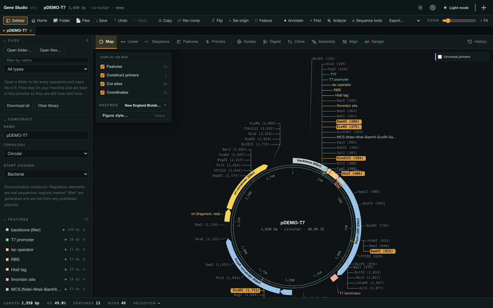

### The sequence

Loci and their cut marks above the line, forward primers next, then both
strands, then each translation drawn **under the residues it belongs to**, and
reverse primers below the strand they run backwards along. A restriction cut is
a stepped `ㄴㄱ` through both strands, so which strand breaks where — and which
way the overhang points — is read off the bases rather than inferred from the
enzyme's name.

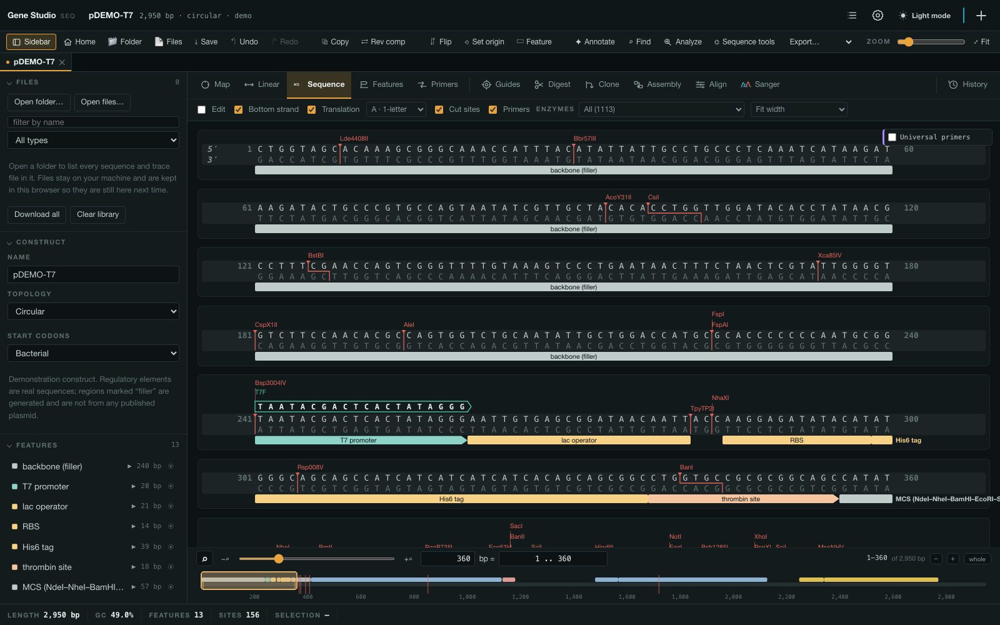

### The linear map

The same molecule unrolled, with its own layer switches: what has to go to make
a ring legible is not what has to go for a row.

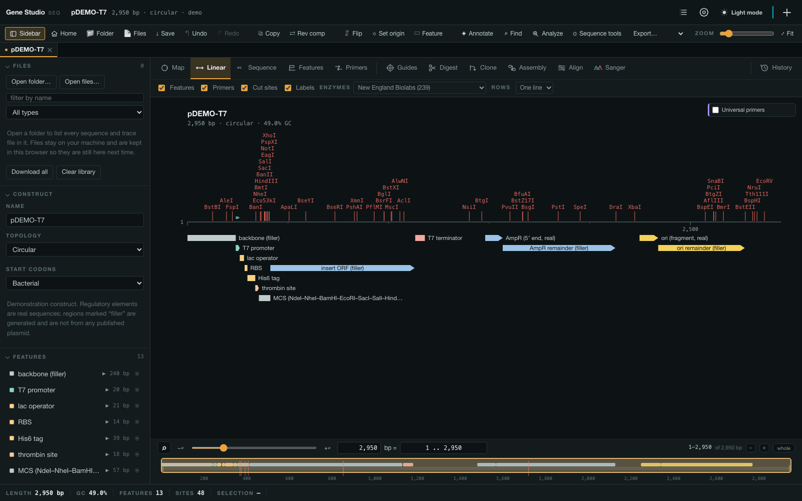

### Digests, on a gel

A real gel's shape: even lanes on a dark slab, the ladder in lane 1, the uncut
control in lane 2. A band's size is on hover, the way a gel is read against its
ladder. Blocked cuts are named under the gel — methylation is checked against
the strain the DNA was grown in, not assumed.

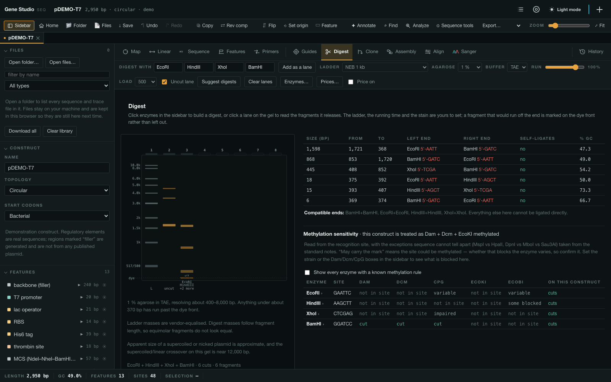

### The feature table

Every field the record carries, a column per qualifier, ordered the way GenBank
writes them — so nothing in the file is quietly dropped by a table with a fixed
set of columns. *Full + computed* adds what is in no GenBank: %GC, mass, pI,
GRAVY and the ribosome binding site with its spacer and score.

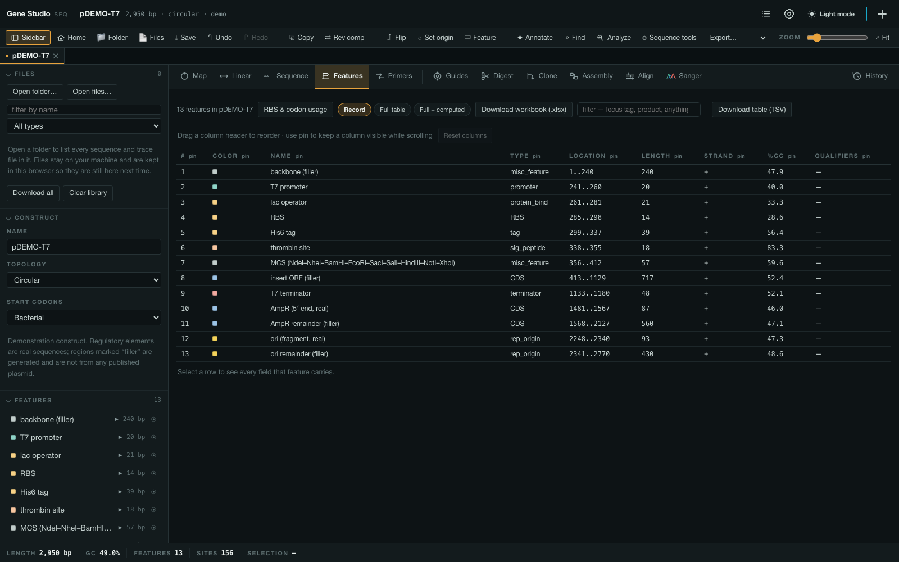

### Primers and PCR

The construct's own primers, the lab's freezer stock and the universal set are
three layers with three switches. A primer is matched by its **3′ end**, since
that is the end a polymerase extends from — a 5′ overhang matches nothing and is
measured rather than required, and a designed mismatch inside the annealing is
the point of a mutagenic primer rather than a failure to bind.

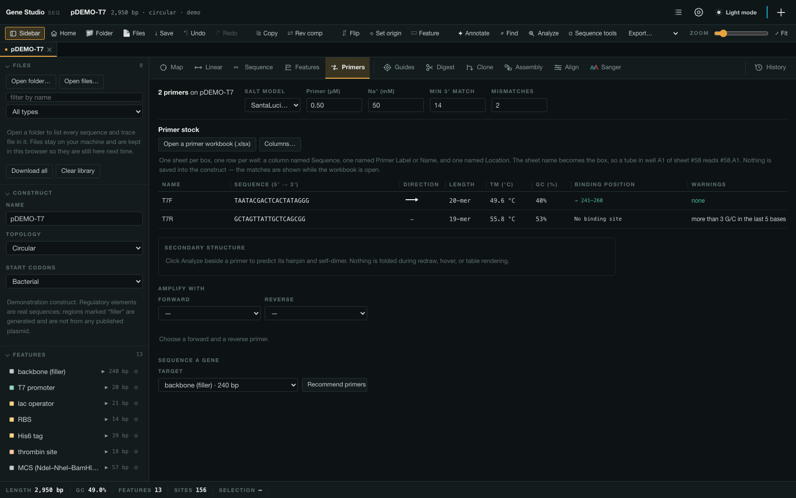

### Guide RNAs and deletion arms

Ported from the author's own PrimerDesigner: guide scoring, Golden Gate oligos,
Gibson inverse-PCR primers and four-primer deletion arms, with the nuclease
table and thresholds copied rather than reinvented.

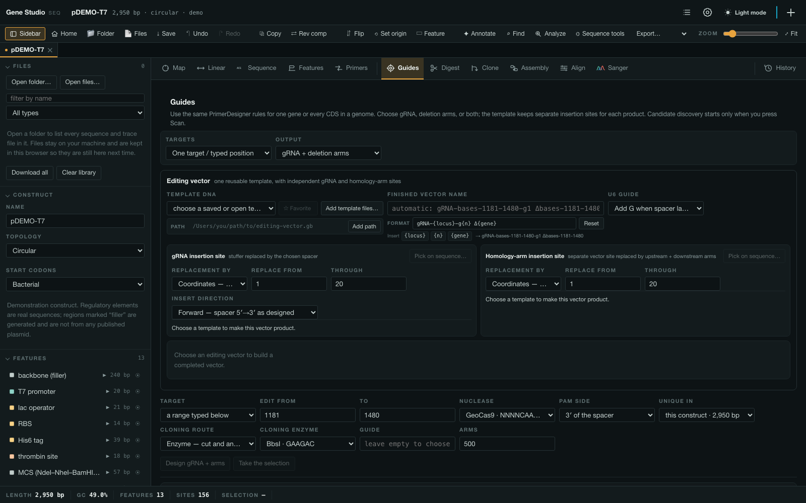

### Cloning

A region of one construct into another: two parents, a region picked on each by
pointing at it, the primers that do the job and the construct that comes out —
side by side, recomputed on every change.

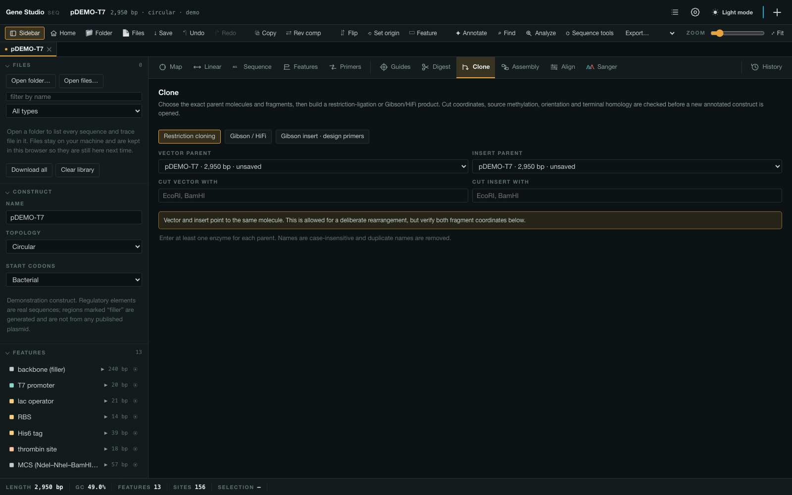

### Golden Gate assembly

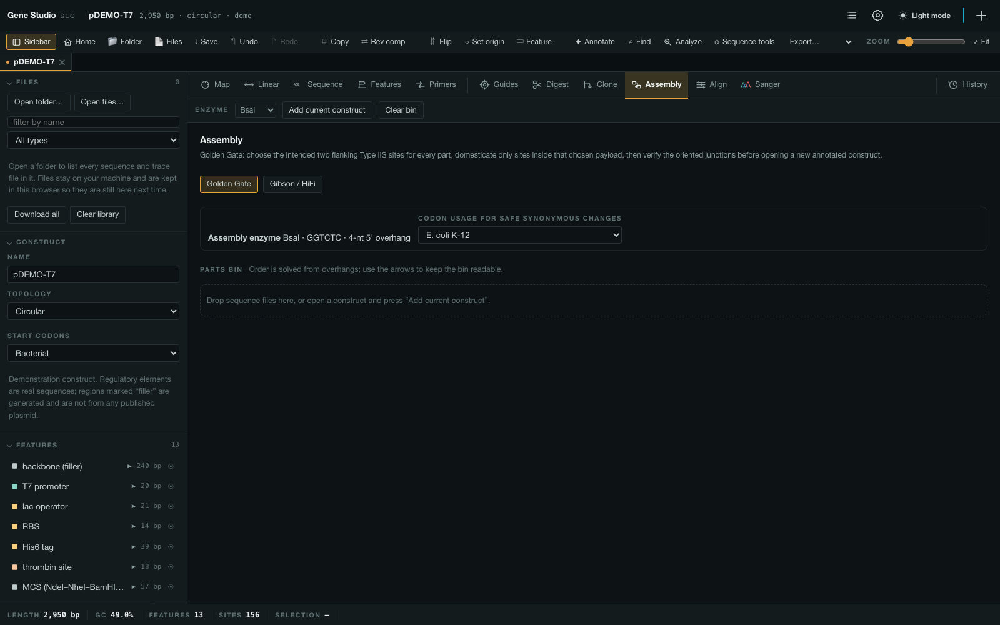

### Sanger reads

A pileup in the construct's own coordinates, each read's chromatogram drawn in
the same columns directly beneath its bases. A read with an indel is aligned
with a gap rather than reported as a wall of mismatches, and a difference is
judged on the neighbourhood's quality — the end of a Sanger read decays, and a
dozen disagreements in a row there is not a dozen variants.

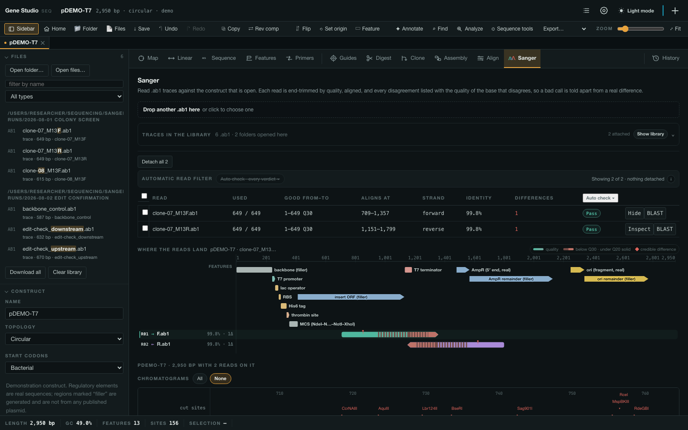

### Figures

Every drawing is SVG — paths and text, not pixels — and exports as vector with
the stylesheet resolved, editable in Illustrator.

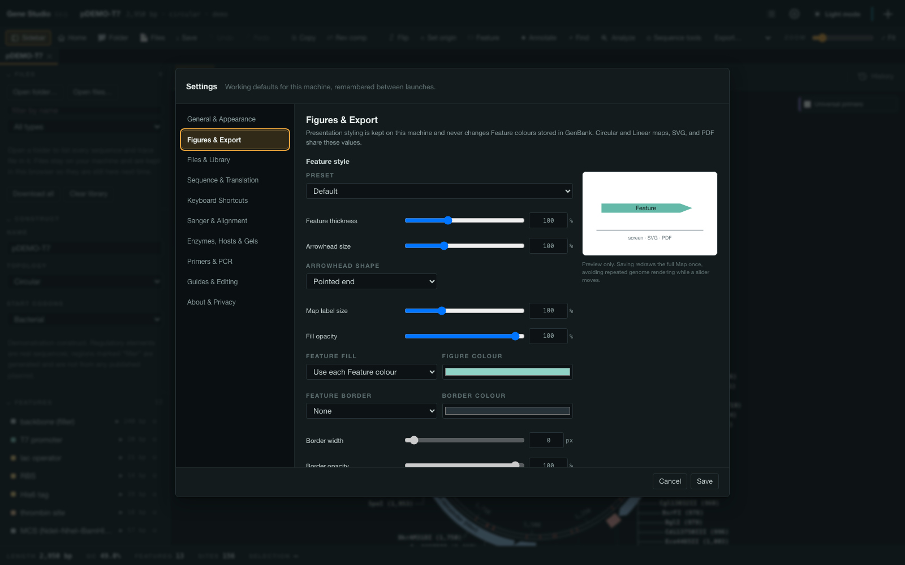

---

## Licence

**Copyright © 2026 Jae-Yoon Sung. All rights reserved.**

Gene Studio is **not open source**. The builds published here are covered by the
[Gene Studio Research Use Licence](LICENSE) — the same terms that ship inside the
application. In short:

- Install and run it on the computer your licence key names, for research,
  teaching and study, including work you publish. Your data, your constructs and
  your findings stay yours.
- **Do not modify it, and do not build anything out of it.** That covers a
  modified build, a repackaged installer, and any other program containing part
  of this one. Taking it apart to obtain the source — decompiling,
  disassembling, unpacking the bundle — is not permitted either, nor is removing
  or altering the licence check, the copyright notices or the attributions.
- Do not pass on the installer, the application or a licence key; do not sell,
  rent or host it as a service, or put it inside a commercial product.
- For research use, ask: the answer is usually yes. Written permission means an
  email from the author saying so — **genestudio.help@gmail.com**.

Authorship and every right in Gene Studio remain with Jae-Yoon Sung. Nothing in
this repository is offered under an open-source licence, and no permission
beyond `LICENSE` is granted by the builds being publicly downloadable. The
third-party components listed below keep their own terms and are not restricted
by it.

---

The restriction-enzyme data is **REBASE**'s (Roberts, Vincze, Posfai & Macelis,
*Nucleic Acids Research*, rebase.neb.com) and should be cited as theirs. MAFFT,
SeqFold and Aioli run locally under their own licences; full notices ship with
the application. The `.dna` reader was worked out from the bytes of real files
for interoperability — Gene Studio contains no SnapGene code and is not
connected with, or endorsed by, SnapGene or Dotmatics.

<!-- gene-studio:release-notes:begin -->
## Release notes

Version-specific changes are retained below. Earlier releases: [GitHub Releases](https://github.com/JAEYOONSUNG/GeneStudio-releases/releases).

<!-- gene-studio:release:1.1.50.7:begin published-at=2026-10-25T06:13:09.000Z -->
### [1.1.50.7](https://github.com/JAEYOONSUNG/GeneStudio-releases/releases/tag/v1.1.50.7) — 2026-10-25

Gene Studio 1.1.50.7 puts the external-service notice where the button that demands it can be read beside it.

- **The notice you are asked to tick is on screen with the button that asks for it.** Pressing Submit in Homolog & domain search — which is where Identify in the 16S panel sends a merged sequence — refused with *review and tick the external-service notice first*, about a tick box that was not on the screen: it was the last thing in the scrolling column, after every provider card, while Submit is pinned to the window. Measured in a 1440×900 window: the button at y 820–852, the notice at 1123–1166, so 365 px below the fold of a column with 384 px hidden under it. Scrolling down reached it, which is how it had gone unreported; nothing said it was there. It is a band of its own above the buttons now, so what is being sent, where it is going and the button that sends it are read in one place — which is the point of saying it at all. Same shape as Unlock sitting 101 px below the fold of the licence window.
- **A refusal points at the box it is about.** Both notices — the one for an external provider and the one for a local DNMBsuite run — now move the keyboard focus to the tick box they are refusing over, rather than leaving the reader to work out which of the things on screen is meant.
<!-- gene-studio:release:1.1.50.7:end -->

<!-- gene-studio:release:1.1.50.6:begin published-at=2026-10-24T21:15:17.000Z -->
### [1.1.50.6](https://github.com/JAEYOONSUNG/GeneStudio-releases/releases/tag/v1.1.50.6) — 2026-10-24

Gene Studio 1.1.50.6 is seventeen fixes to the 16S identification panel, including one that stopped its drop zone taking a drop at all.

- **Reads dropped on the 16S panel go to the 16S panel.** They never did: the window raises a full-screen veil the moment a file drag enters it, and that veil — not the zone under it — was what every drop landed on, so reads dropped on "Drop .ab1 reads here" were filed against whatever construct happened to be open and the view switched to Sanger. Measured by asking the page what sits in the middle of the drop zone during a drag: the veil. The two other ways in, the Choose button and the attached reads, were unaffected.
- **The last bases two reads share are judged, not assumed.** The window handed to the aligner is measured along a diagonal, which counts no insertions — so an insertion in one read pushed the last shared bases outside it, where they were filed as the end of a read rather than as a place the two reads disagree. Measured: seven bases where a Q50 read disagreed with a Q20 read came back as the poorer read's, with the row saying 393 of 393 at 100 %.
- **Two reads that disagree where both of them are good are refused.** The stretch where both reads are well called could only ever rescue a pair, never refuse one — so a pair agreeing at 94 % overall was merged while half of the bases both reads called well disagreed. Agreement over a short stretch can be the gene being conserved; disagreement where both reads are good cannot.
- **Two files of one name arriving together are no longer both taken.** A name was checked against the files already loaded but not against the rest of the same drop, so the second quietly replaced the first — and a name is now one name whatever its capitals, since this is a filesystem that will not hold two of them in a folder.
- **A hit whose identity could not be worked out is unknown, not zero.** It was being read as a record 99 points away, which is exactly backwards: an unknown rival settled an identification instead of leaving it open. And a record with no organism name that is demonstrably far away no longer vetoes an answer nothing is competing with.
- **The figure marks a disagreement where it sits in the merged sequence.** It was marking it where it sits in the *forward read*, which is not the same place the moment the reverse read reaches further left than the forward one — and 9F and 1492R are not aimed at the same base. Measured: a pair differing at exactly one of the 700 bases it shares was drawn with 201 marks, which is the wall of red this figure draws when a pair is wrong.
- **An overlap long enough to join on can still be thin evidence, and the row says so.** A 16S gene is conserved in blocks of 50–100 bases, so two reads that barely meet agree perfectly rather more easily than two that overlap properly. Under 150 shared bases the row says how little the join rests on instead of saying "They agree" in the same words it uses for a 500-base overlap.
- **A search that is still running, one that ended badly, and one that was run before the trimming changed all said nothing at all** — the same blank as a sample nobody had asked about. Each says what it is now, about the newest attempt at that sequence, and a provider asking to be left alone for a minute is no longer reported as a search that died. The last of those is the trimming control's own doing: a row is matched on the merged sequence, so changing the trimming rightly takes the name off every row that had one, and with nothing said it looked like the answers being thrown away.
- **Three things that were there and said nothing.** A third file for one sample — `-9F`, `-27F` and `-1492R` is a real way a plate comes back — was kept and never shown, so the row listed two reads as though that were all there was; an attached read with no bases to take was passed over while the button beside it had just counted it; and a file with no primer at the end of its name was called a forward read, which is a claim about the file rather than a description of it.
- **The panel's own two menus are the app's own again.** A menu built by a view render stayed the system's popup until some later redraw found it: measured, 2 of the 93 menus on screen, and they were these.
- **The merged figure holds its own letters.** The labels sat on a baseline that left their line box ending exactly on the figure's edge, so every descender was painted outside it and covered by the next row — on the installed build it read *overtap 865 bp*.
- **Smaller things.** A row no longer says two reads agree at *all* the bases they share when it has just counted one that they do not; Clear no longer leaves the last drop's warning standing over an empty panel; and the walk that joins two reads no longer searches its column list from the start at every deletion.
<!-- gene-studio:release:1.1.50.6:end -->

<!-- gene-studio:release:1.1.50.5:begin published-at=2026-10-24T12:26:38.000Z -->
### [1.1.50.5](https://github.com/JAEYOONSUNG/GeneStudio-releases/releases/tag/v1.1.50.5) — 2026-10-24

Gene Studio 1.1.50.5 adds a 16S identification workspace, opens Sanger inspection on the aligned view, and fixes a plasmid nobody cut being reported as cut.

- **A 16S workspace: two reads of one gene, joined and searched as one sequence.** Drop the forward and reverse reads of each sample — `9F` and `1492R`, or any pair whose names end in F and R — and each pair is merged into the contig neither read reaches alone, then sent to NCBI blastn against the curated 16S type-strain set. Where the two reads disagree the better call wins: the base's own Phred, qualified by its neighbourhood and by how far it sits from the read's decaying end. Measured on six real pairs, the overlap runs 627–865 bases and agrees 99.5 % of the time or better where both reads are good; merged, the five samples of one species come out identical to each other and 79 % against the one that is a different genus. Two reads that are not one sample are refused rather than joined — but only when the disagreement is not explained by one read having decayed, since that is what the ends of a Sanger read do. Each row draws where the two reads meet, says which of identity, coverage and the distance to the next species is standing between it and a name, and keeps the answer beside the sample it belongs to.
- **Sanger inspection opens on the aligned view, on the pileup's own columns.** The card used to open on the original trace, so seeing which peak matched which base of the construct took a press every time; and it built its columns from the one read it was showing, so where another read carried an insertion the same stretch sat three columns apart in the two panels. A call with no column of its own — a trimmed end, an off-template block, an unaligned read — still shows its original trace and says why.
- **Taking reads off keeps the place you were reading.** Detaching one read sent the inspection back to the start, detaching the inspected read left the card blank, and the pinned column in the pileup slid by every column the removed read had inserted. The inspected read now stays on its call; if it goes, the next read covering the same base is opened there.
- **A plasmid nobody cut is no longer reported as cut through anything.** With no enzyme picked, the one piece starts at the origin — and reading that as a cut made a feature crossing the origin come back as destroyed by a digest with nothing in it. The same row called an uncut circle's ends open; it reads as circular and closed.
- **A feature the colour of the paper is still drawn as a feature.** A white fill had no edge at all: measured against the light theme's paper it came out at 1.00 contrast, so the bar took its lane, carried its name and showed nothing, and on the ring it was a gap. It is given a hairline of its own colour now, in all three drawings.
- **The Guides panel stays where you left it.** Every press rebuilt the view and the page jumped — measured, choosing a candidate threw the pressed button 294 px up. A genome-wide run can also be given a numbered stretch of the CDS list, stopped part-way without losing what it has designed, and carried on from where it stopped; the panel says plainly that the designs live in that window until one of the two downloads is pressed.
- **How it works has a page on the 16S workspace**, and those pages are drawn by a test for the first time — which found two of them printing their own asterisks, since that page renderer reads `**bold**` and `` `code` `` and nothing else.
- **The merged figure is drawn at the size it is given**, on a phone as on a desktop. It carries a viewBox, so filling the card stretched it sideways and not down — the labels came out 1.8 times wide and ran off the end of the bar they belong to — and the two bulk buttons were wider than the window. (Both came out of making the screenshot harness tell the truth: macOS will not make a headless window narrower than 500 px, so every phone capture had been a 500 px layout with its right-hand side cut off.)
- **Smaller things.** One base selected in Sanger no longer opens Digest's selected-stretch card about it, or offers itself as a sequencing target without saying what it is; a long read name and its figure no longer print over each other in the phone's read map.
<!-- gene-studio:release:1.1.50.5:end -->

<!-- gene-studio:release:1.1.50.4:begin published-at=2026-10-22T12:49:48.000Z -->
### [1.1.50.4](https://github.com/JAEYOONSUNG/GeneStudio-releases/releases/tag/v1.1.50.4) — 2026-10-22

Gene Studio 1.1.50.4 makes the Guides panel's two insertion sites tellable apart wherever they are drawn, and stops its fields getting worse as the window gets wider.

- **The gRNA and homology-arm sites carry one colour each, everywhere.** The legend dot beside the template, the mark on the preview ring, the underline under the site's own bases and the card you type the coordinates into were not agreeing; the colour had in fact never reached the two cards at all. They are a red and a blue now, each chosen for the theme it is read on rather than one pair asked to work on both — and the colour written into a saved vector is unchanged, so a file made by an earlier build opens the same.
- **Both sites can be found on the preview ring.** A 20 bp site on a 2.7 kb plasmid was about three pixels of arc, drawn among the template's own features at whatever radius happened to be free — so the two marks the card exists to compare read as two different kinds of thing. They sit together outside the features now, at a size the eye can land on, and two sites set to the same bases are drawn as two marks rather than one on top of the other.
- **The editing-vector fields no longer get narrower as the window gets wider.** On a wide screen *Template DNA* came out narrower than it does on a laptop and *U6 guide* was stranded alone on a row of its own. The block keeps the same two-by-two at every width, and three menus that had been cut short on a wide screen — the template, where it was grown and the spacer rule — now show their whole text.
- **A replacement range is one line.** *Replace from* and *through* are the two ends of one span and were being laid out as two unrelated fields, which on a wide card put them on opposite diagonals with a gap between them. They are side by side, at the same width as every other number box in the panel.
- **The sequence picker is as tall as its own text.** The band of bases you pick a site on was reserving a lane sized for the full sequence view — about eleven pixels per row more than it needed — so the strip was a fixed, over-tall box whatever was in it.
<!-- gene-studio:release:1.1.50.4:end -->

<!-- gene-studio:release:1.1.50.3:begin published-at=2026-10-21T17:08:54.000Z -->
### [1.1.50.3](https://github.com/JAEYOONSUNG/GeneStudio-releases/releases/tag/v1.1.50.3) — 2026-10-21

Gene Studio 1.1.50.3 takes a whole genome-wide guide design away in one file, and quiets two panels that were marking the same thing four times over.

- **A genome-wide run comes away whole**: *Download workbook + every vector (.zip)* puts the primer workbook and one annotated GenBank per design in a single archive, instead of a hundred CDS meaning a hundred presses on a hundred selected rows. A design whose vector cannot be rebuilt is named in `not-saved.txt` rather than being quietly one file fewer, and two designs that want the same file name are both kept.
- **Designing every annotated CDS at once says so where the choice is made.** It was always one option above Output — *All CDS — genome-wide* — and read as not existing at all.
- **The Guides panel is marked by its cards, not by rails down their edges.** A selected row was carrying its wash, a blue rank chip, a blue score, the word *Selected* **and** a 3 px rail — which, drawn as an inset shadow inside a rounded card, was clipped to a point at both ends. The rails are gone; what each of them was actually saying — which site a change belongs to, which arm a fragment is — is kept as the card's own border and ground.
- **A methylation tally is no longer dressed as a warning**: the summary takes its amber only when the assessment found an overlap or an interference to look at, and takes it from the theme rather than from a colour fixed against a white page.
- **The two primer inventories wear calmer labels, and one fewer meaning.** *This construct* was in the forward-primer green while, two columns to its right, the same green marks a forward primer — so the live list takes the accent and the freezer takes slate. The chips are read at reading size rather than shouted in capitals, and the line saying which construct the rows belong to is legible.
<!-- gene-studio:release:1.1.50.3:end -->

<!-- gene-studio:release:1.1.50.2:begin published-at=2026-10-21T09:30:14.000Z -->
### [1.1.50.2](https://github.com/JAEYOONSUNG/GeneStudio-releases/releases/tag/v1.1.50.2) — 2026-10-21

Gene Studio 1.1.50.2 turns the licence request into a form, puts a map of the whole template under the Guides picker, and lets an editing vector say which strain it was grown in — which is what decides whether the enzyme can cut it.

- **Asking for a licence is a form, not an empty mail**: name, e-mail, lab or institution and country are fields in the window, all required and all named in one answer. Well-known institutions and every country are searchable as you type, so the request arrives complete and the only thing left to decide is how long it runs.
- **The desk decides how long**: an approval period set on the desk is the period issued, so a trial given a year is a year rather than silently a month.
- **A navigator under the template picker**: a strip of the whole template sits below the bases with the gRNA site and the homology arms drawn on it, so moving between them is a press rather than a long drag. A feature crossing the origin is drawn as its two pieces, the readout says where the window really is, and a drag that runs past the laid-out window moves it when the pointer is released rather than mid-scrub.
- **The strain an editing vector was grown in**: choose it on the editing-vector card and the note judges the two cloning sites flanking the stuffer — not the whole vector, which was wrong in both directions: a warning for a blocked site nowhere near the insertion point, and a clean verdict for a vector the enzyme cannot cut at all. A strain profile this copy cannot read is said to be unassessed rather than treated as having no marks.
- **Sanger `.ab1` inspection** is laid out on its own frame again, with the waveform, the base, quality and reference rows aligned to one axis.
- **Pasting a protein** is read as amino acids instead of being refused as a sequence with bad letters.
<!-- gene-studio:release:1.1.50.2:end -->

<!-- gene-studio:release:1.1.50.1:begin published-at=2026-10-21T00:31:15.000Z -->
### [1.1.50.1](https://github.com/JAEYOONSUNG/GeneStudio-releases/releases/tag/v1.1.50.1) — 2026-10-21

Gene Studio 1.1.50.1 brings Sanger review that shows deletions, insertions and junctions on the read map, and reads much more of what SnapGene keeps in a `.dna`, including its history of how a construct was made.

- **Sanger traces**: the whole read scrolls sideways with the wheel or a drag, at Compact, Standard or Wide spacing, and peak heights are scaled to the signal nearby. The trace keeps its place when the view is rebuilt.
- **Sanger structure**: a deletion is cut into its read on the map, an insertion is marked, and a read that matches at the start and then carries something else is drawn that way. Every matching stretch is found, short ones included, on both strands. Indels in a region that only loosely matches the construct are marked as unconfirmed. On a genome the map zooms to where the reads are.
- **SnapGene colours and notes**: colours set with Set DNA Color are read, drawn and written back. The organism, the strain a construct was transformed into, natural or synthetic, DNA ends, citation details, primer descriptions and colours, and hidden features and primers come through. Multi-value qualifiers (db_xref, GO terms, notes), `transl_except` and collection dates are no longer lost.
- **SnapGene history**: the History view shows how a construct was made in SnapGene — each edit and cloning step with what went into it — and any earlier version opens as its own tab.
- **Segment colours**: a feature coloured piece by piece in SnapGene (for example a mutated codon inside a gene) is drawn piece by piece on the map, the linear view and the sequence.
- **Digest from a selection**: select a stretch and open Digest to see the enzymes that cut only inside it and the pairs that cut it out, with fragment size and whether the remaining ends rejoin. Isoschizomers are grouped only when they cut alike, methylation included.
- **Hiding features**: right-click a feature on the map to hide it, the selected features, or every feature of its type. The Features panel lists what is hidden, with Show and Show all. Hiding can be undone and is kept in GenBank and `.dna` files.
<!-- gene-studio:release:1.1.50.1:end -->

<!-- gene-studio:release:1.1.50:begin published-at=2026-10-18T13:15:10.000Z -->
### [1.1.50](https://github.com/JAEYOONSUNG/GeneStudio-releases/releases/tag/v1.1.50) — 2026-10-18

Gene Studio 1.1.50 gathers every earlier build into one release. From here on, updates are numbered 1.1.50.1, 1.1.50.2 and so on. Copies on a 1.4.x build cannot update to it by themselves: download it once from this page, and later updates install themselves.

- **Maps**: circular and linear maps of double- and single-stranded molecules. Features are packed per strand, names are placed on the arc or in margin columns with curved or straight leader lines, and crowded poles stack outward. A cut tick shows the end it leaves. Primers are drawn as arrows with their 5′ tails. Hover cards cover features, primers and cuts. Selections can be measured as arcs and read as the two fragments they make. A multiline centre title is optional, and cut-site shortcuts cover All, Unique, Double and 3+ cutters.
- **Sequence view**: both strands with gggenes-style feature arrows, translations under their codons, primers above and below, and stepped cuts through both strands. Includes a whole-molecule navigator, ⌘A select-all with copy, a copy button on each bottom readout value, and a Find similar comparison that aligns a query through insertions and deletions against the reference.
- **Find and go to**: DNA (IUPAC and regular expressions, widening to near matches), protein over translated regions, any feature field, and Go to a base or range. Searches start from the current selection or reading position, and the last searches are a key away.
- **Digests and gel**: 1,113 REBASE enzymes with the Commercial set as default, and Dam/Dcm/EcoKI methylation checked against the host strain. The simulated agarose gel shows ladders, tracking dyes (including NEB purple and Orange G) and a bigger plate. Suggest digests is included.
- **Feature table**: every qualifier as a column in GenBank order, plus computed %GC, mass, pI, GRAVY and RBS scoring. Columns can be pinned. CDS cards show the protein, accessions and qualifiers.
- **Primers and PCR**: matching by the 3′ seed, with the lab freezer workbook (any layout via Columns…), stock box and well locations, an Exact matches only filter, and two-row PCR size readouts. ⌘R opens a primer from a selection or search hit, and ⌘D opens a PCR fragment or selected DNA as a new linear construct with annotations kept.
- **Cloning and assembly**: restriction and Gibson cloning, Golden Gate with domestication and warnings for internal sites, and Join parts with PCR primer design for Gibson/HiFi and Golden Gate.
- **Guide RNAs**: guide scoring and ranked candidates at alternative positions, Golden Gate oligos, Gibson inverse-PCR and four-primer deletion arms. Methylation of the target DNA is assessed per strain, and Guide design opens straight from a selected CDS.
- **Sanger**: `.ab1`/`.abi` traces (including `.gz`) shown as a pileup in construct coordinates, with chromatograms under their bases, gapped alignment of indels and quality-aware calls. A live traces folder follows Finder renames, and the library shows Cards or Details.
- **Align and trees**: ggmsa-style alignments with figure export and sequence logos, plus per-column inspection and local sequence analyses. IQ-TREE 3 with ModelFinder, UFBoot and SH-aLRT, ancestral states, and a Tree studio with layouts, presets, heatmap layers, symbols and clade backgrounds.
- **Homology and analyses**: NCBI and UniProt BLAST, HMMER, Pfam, CD-Search, Foldseek, HHpred and AlphaFold Server handoffs, with retrieval of hit sequences. SignalP 5 and 6, InterProScan, eggNOG, DefenseFinder and Prodigal pipelines run with visible progress.
- **Strain DB**: 54 built-in strains from 50 NCBI reference genomes. Each has codon, tRNA and RBS evidence, plus restriction–modification systems with linked M/R/S/C loci, catalytic and cofactor motifs measured against predicted structures, Type I half-site reading, and REBASE strain and locus comparison. The profile list stays on screen while the import column changes.
- **DNMB**: imports DNMBsuite result folders and runs modules in an isolated Docker container. Prepare fetches each module's databases once. Connected reports survive updates and can be detached, and 17 bundled reports are drawn as responsive panels from their chart data.
- **Files and Home**: GenBank, FASTA, SnapGene `.dna` (methylation flags kept), ApE, xlsx and Sanger formats, detected by content rather than file extension. Save As makes a copy in a new tab. Home has starred files, full recent history, last-viewed dates and sorting, a single clear button in search, and reorderable file tabs.
- **Window and platforms**: view tabs span the window above the sidebar, with a dark theme, drawn menus throughout and Escape closing the open dialog. macOS document icons and a branded installer are included. Builds are Windows Setup and portable, Linux AppImage and `.deb` with MIME types, and a web viewer and iPhone home-screen app.
- **Licence and updates**: an offline machine-bound licence that renews or is revoked by itself, with a request form. Licences verify against a second author key. The Mac build is signed and notarized. One-press updates download, install and restart on macOS, Windows and AppImage.
<!-- gene-studio:release:1.1.50:end -->
<!-- gene-studio:release-notes:end -->
